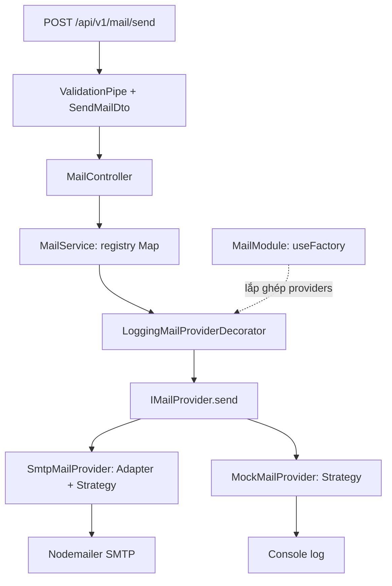

# Bài tập OOP: module gửi email với NestJS

## Chạy và thử API

Yêu cầu **Node.js >= 20** cho Nodemailer 10, npm và PostgreSQL khi chạy toàn
bộ boilerplate. Nodemailer 10 đã có TypeScript definitions nên không cài thêm
`@types/nodemailer`. Nguồn: [Nodemailer requirements](https://nodemailer.com/#requirements).

Docker và GitHub Actions dùng Node 22 để đáp ứng yêu cầu runtime này.
Khi chạy trên máy chủ đã có sẵn, cần chọn Node >= 20 trước khi khởi động app.

```bash
npm install
cp .env.example .env
docker compose up -d init_db
# Hoàn thành cấu hình database/migration của boilerplate bên dưới nếu cần.
npm run start:dev
```

Chỉ chạy lệnh `cp` khi chưa có `.env`; nếu đã có, thêm các biến mail vào file
hiện tại. Không đưa tài khoản SMTP thật vào Git.

```dotenv
MAIL_DEFAULT_PROVIDER=mock
SMTP_HOST=smtp.ethereal.email
SMTP_PORT=587
SMTP_USER=
SMTP_PASS=
SMTP_FROM=
```

Mặc định `mock` chỉ log email ra terminal, không kết nối SMTP. Muốn thử SMTP,
điền tài khoản [Ethereal](https://nodemailer.com/guides/testing-with-ethereal) hoặc máy
chủ SMTP của bạn; đặt `MAIL_DEFAULT_PROVIDER=smtp` hoặc chọn trong request.
`SMTP_FROM` bỏ trống sẽ dùng `SMTP_USER`. Cổng 465 dùng TLS ngay; 587 dùng
STARTTLS khi server hỗ trợ. Transporter được tạo ở lần gửi SMTP đầu tiên và
tái sử dụng. Nguồn: [SMTP transport](https://nodemailer.com/smtp),
[Nodemailer createTransport](https://nodemailer.com/#create-a-transporter).

```bash
curl -X POST http://localhost:3000/api/v1/mail/send \
  -H 'Content-Type: application/json' \
  -d '{"to":"student@example.com","subject":"Bài tập OOP","content":"Xin chào!"}'
```

Kết quả mock, HTTP 200:

```json
{ "success": true }
```

Gửi HTML qua SMTP:

```bash
curl -X POST http://localhost:3000/api/v1/mail/send \
  -H 'Content-Type: application/json' \
  -d '{"to":"student@example.com","subject":"Bài tập OOP","content":"<h1>Xin chào!</h1>","isHtml":true,"provider":"smtp"}'
```

SMTP thành công trả `{ "success": true, "messageId": "..." }`. Điều này
nghĩa là SMTP server đã nhận thư để xử lý, chưa đảm bảo thư vào inbox.
Ethereal giữ email trong hộp thư thử nghiệm, không chuyển tới người nhận thật.
Nguồn: [Nodemailer response](https://nodemailer.com/#response-object),
[Ethereal testing](https://nodemailer.com/guides/testing-with-ethereal).

| Trường               | Quy tắc                                                                        |
| -------------------- | ------------------------------------------------------------------------------ |
| `to`                 | Bắt buộc, một địa chỉ email hợp lệ: `@IsEmail()`                               |
| `subject`, `content` | Bắt buộc là string, không rỗng hoặc toàn khoảng trắng                          |
| `provider`           | Tùy chọn: `smtp` hoặc `mock`; bỏ qua/null thì dùng default                     |
| `isHtml`             | Tùy chọn boolean; `true` gửi HTML, còn lại gửi text; chuỗi `"true"` bị từ chối |

DTO là class có decorator của `class-validator`; `ValidationPipe` trong
`main.ts` dùng `transform: true` để tạo DTO qua `class-transformer` và
`whitelist: true` để bỏ trường lạ. `@IsOptional()` bỏ qua cả `null` lẫn
`undefined`. Xem [SendMailDto](src/modules/mail/dto/send-mail.dto.ts),
[Nest validation](https://docs.nestjs.com/techniques/validation),
[class-validator](https://github.com/typestack/class-validator#validation-decorators).

Ví dụ `{"to":"invalid-email-format","subject":""}` trả HTTP 400,
`message` là mảng lỗi cho `to`, `subject`, `content`. Provider không được
hỗ trợ cũng trả 400; thiếu/sai cấu hình SMTP trả 503; lỗi kết nối, xác thực
hoặc từ chối thư trả 502 với thông báo chung `Mail delivery failed`.
Không trả chi tiết lỗi SMTP hoặc mật khẩu trong HTTP response.

## Kiến trúc và nơi áp dụng



| Thành phần                                                                                          | Trách nhiệm                                                   |
| --------------------------------------------------------------------------------------------------- | ------------------------------------------------------------- |
| [mail-provider.interface.ts](src/modules/mail/mail-provider.interface.ts)                           | Contract `SendMailOptions`, `MailSendResult`, `IMailProvider` |
| [mail.service.ts](src/modules/mail/mail.service.ts)                                                 | Registry, chọn strategy, điều phối và chuẩn hóa lỗi gửi       |
| [smtp-mail.provider.ts](src/modules/mail/providers/smtp-mail.provider.ts)                           | Adapter sang Nodemailer và xử lý cấu hình SMTP                |
| [mock-mail.provider.ts](src/modules/mail/providers/mock-mail.provider.ts)                           | Mô phỏng gửi bằng log, không gọi mạng                         |
| [logging-mail-provider.decorator.ts](src/modules/mail/providers/logging-mail-provider.decorator.ts) | Bọc provider, log kết quả và giữ nguyên kết quả/lỗi           |
| [mail.module.ts](src/modules/mail/mail.module.ts)                                                   | Cấu hình DI và factory lắp các provider                       |
| [mail.controller.ts](src/modules/mail/mail.controller.ts)                                           | Nhận HTTP request và gọi service                              |
| [mail-exception.filter.ts](src/modules/mail/mail-exception.filter.ts)                               | Giữ nguyên mã HTTP và danh sách lỗi validation cho mail       |

### 1. Strategy Pattern: thay cách gửi lúc chạy

Strategy đóng gói những cách thực hiện cùng một công việc sau một interface,
để client thay thế chúng mà không phụ thuộc từng thuật toán cụ thể.
Nguồn gốc: [GoF, Strategy trong phần giới thiệu](https://people.csail.mit.edu/addy/pattern/chap1.htm).

Ở đây `IMailProvider` là Strategy, SMTP và mock là Concrete Strategies,
`MailService` là Context. Service chỉ thực hiện `provider.send(options)`;
nó không cần biết kết nối SMTP hoặc log nội dung hoạt động như thế nào.
Tên provider đến từ request hoặc `MAIL_DEFAULT_PROVIDER`, được lấy từ `Map`.
Không lưu provider đang chọn vào một field dùng chung, nên hai request chọn
hai provider khác nhau không ghi đè lựa chọn của nhau.

### 2. Factory Pattern: tập trung việc lắp ghép object

Factory tách quyết định tạo object khỏi nơi sử dụng. Riêng **GoF Factory
Method** dùng phương thức tạo object để subclass quyết định concrete class.
Nguồn: [GoF Factory Method](https://people.csail.mit.edu/addy/pattern/pat3c.htm).

Bài này dùng **factory function của NestJS DI** tại `MailModule.useFactory`:
Nest tạo/inject hai concrete provider; factory bọc mỗi object bằng
`LoggingMailProviderDecorator` và trả danh sách cho token `MAIL_PROVIDERS`.
Đây là ứng dụng factory để lắp ghép dependency, không phải GoF Factory Method
theo mô hình kế thừa. Registry chọn instance đã có cho từng request, không
tạo lại provider. Không cần thêm lớp factory chỉ để đổi tên một phép lookup.
Nguồn: [Nest factory providers](https://docs.nestjs.com/fundamentals/custom-providers#factory-providers-usefactory).

Token `Symbol('MAIL_PROVIDERS')` dùng được ở runtime; interface TypeScript bị
xóa khi compile nên không dùng trực tiếp `IMailProvider` làm DI token.
Nguồn: [Nest custom provider tokens](https://docs.nestjs.com/fundamentals/custom-providers#non-class-based-provider-tokens).

### 3. Open/Closed Principle: mở rộng provider, giữ ổn định điều phối

OCP khuyến khích thiết kế module để thêm hành vi bằng mở rộng, hạn chế sửa
logic ổn định mỗi lần có biến thể mới. Không có thiết kế nào đóng với mọi
loại thay đổi; cần xác định hướng mở rộng cần bảo vệ.
Nguồn: [Robert C. Martin, OCP](https://blog.cleancoder.com/uncle-bob/2014/05/12/TheOpenClosedPrinciple.html),
[Strategic closure](https://blog.cleancoder.com/uncle-bob/2013/03/08/AnOpenAndClosedCase.html).

Hướng mở rộng ở đây là **dịch vụ gửi email**. Để thêm Resend:

1. Viết `ResendMailProvider implements IMailProvider`, tên `resend`.
2. Đăng ký class trong `MailModule.providers` và thêm vào danh sách `inject`
   của factory; factory hiện có tự bọc logging cho mọi provider được inject.
3. Thêm `RESEND = 'resend'` vào `MailProvider` để DTO chấp nhận request mới.
4. Thêm cấu hình/provider tests; có thể đổi default sang `resend`.

Không sửa `MailService.send()`, lookup hoặc controller. Vẫn phải sửa phần
đăng ký DI và enum whitelist: OCP không có nghĩa không được sửa file cũ nào.
`register()` từ chối tên trùng; tên lạ và default sai không âm thầm dùng mock.

### 4. Single Responsibility Principle: tách theo lý do thay đổi

SRP nhóm những phần thay đổi vì cùng lý do và tách những phần thay đổi vì
lý do khác nhau; không phải mỗi lớp chỉ được có một phương thức.
Nguồn: [Robert C. Martin, SRP](https://blog.cleancoder.com/uncle-bob/2014/05/08/SingleReponsibilityPrinciple.html).

Thay hợp đồng HTTP sửa DTO/controller; thay thư viện SMTP sửa adapter;
thay cách log sửa decorator; thay danh sách provider sửa composition trong
module. Service giữ trách nhiệm điều phối gửi mail, bao gồm registry nhỏ
theo đúng đề, thay vì bị chia thành nhiều lớp chỉ để chuyển tiếp lời gọi.

### 5. Adapter Pattern: nối contract của ứng dụng với thư viện

Adapter chuyển một interface có sẵn sang interface mà client mong đợi.
Nguồn: [Trích GoF về Adapter, InformIT](https://www.informit.com/articles/article.aspx?p=1398600).

`SmtpMailProvider` nhận `SendMailOptions`, đổi `content` sang `text`/`html`,
thêm `from` từ config, rồi gọi Nodemailer `transporter.sendMail()`. Kết quả
riêng của Nodemailer được chuyển về `{ success, messageId }`. Service không
import Nodemailer hoặc phụ thuộc kiểu kết quả SMTP. Cùng một class vừa là
Adapter đối với Nodemailer, vừa là Strategy đối với MailService; hai vai trò
khác nhau này không cần hai lớp trùng chức năng.

### 6. Decorator Pattern: bổ sung logging bằng composition

GoF Decorator bọc một object, giữ cùng interface và bổ sung hành vi trước/sau
khi ủy quyền cho object bên trong.
Nguồn: [GoF Decorator](https://people.csail.mit.edu/addy/pattern/pat4d.htm).

`LoggingMailProviderDecorator implements IMailProvider` giữ `inner`, chuyển
tiếp `name` và `send()`, log metadata thành công/thất bại rồi trả nguyên kết
quả hoặc ném lại lỗi gốc. Cả SMTP và mock dùng chung wrapper này; không phải
chép logging vào từng provider.

Đây là **object wrapper**, khác với cú pháp `@Injectable()`, `@IsEmail()` của
TypeScript/NestJS. Chỉ dùng các annotation đó chưa phải áp dụng GoF Decorator.
Nguồn: [TypeScript decorators](https://www.typescriptlang.org/docs/handbook/decorators.html).

## Kiểm thử và giới hạn

```bash
# Unit + HTTP integration cho mail, không cần database/SMTP thật
npm test -- --runInBand --testPathPattern=modules/mail

# Toàn bộ test và build
npm test -- --runInBand
npm run build
```

Test kiểm tra default/override, registry mở rộng, tên sai/trùng, cấu hình SMTP,
text/HTML, tái sử dụng transporter, log decorator, lỗi gửi và validation HTTP.
Test adapter chỉ giả lập ranh giới Nodemailer; test HTTP khởi tạo MailModule
thật trên cổng loopback tạm thời, không dùng AppModule/PostgreSQL.

`MailExceptionFilter` chỉ áp dụng cho controller mail vì filter i18n chung
của boilerplate lấy lỗi đầu tiên, trái yêu cầu trả danh sách của đề.
Các endpoint cũ giữ nguyên cách xử lý lỗi.

Mock cố ý log nội dung theo đề. Decorator chỉ log metadata, nhưng middleware
ghi request có sẵn của boilerplate vẫn log body. Endpoint này phục vụ bài
tập và chưa gắn guard xác thực. Không thêm SendGrid/Resend, queue hoặc retry;
retry gửi email cần cân nhắc gửi trùng. Chưa kiểm tra gửi qua SMTP thật.

Trước thay đổi, toàn bộ Jest đã có lỗi tại `auth.service.spec.ts`,
`auth.controller.spec.ts` (fixture/kiểu DTO cũ), `media.service.spec.ts` và
`media.controller.spec.ts` (thiếu DI).
Chúng nằm ngoài phạm vi bài mail; hướng dẫn chạy boilerplate gốc ở dưới.

---

# NestJS boilerplate

<p align="center">
  <a href="http://nestjs.com/" target="blank"></a>
</p>

[circleci-image]: https://img.shields.io/circleci/build/github/nestjs/nest/master?token=abc123def456
[circleci-url]: https://circleci.com/gh/nestjs/nest

<p align="center">NestJS Boilerplate</p>

## Prerequisites

- [Node.js](https://nodejs.org/en) v20+
- [PostgreSQL](https://www.postgresql.org/)

## Installation

```bash
# install packages
$ npm install

# init database
$ docker compose up -d init_db
```

If you encounter the error related to `argon2` then uncomment the following command in `docker-compose.yml` file

```yaml
command: sh -c "npm rebuild argon2 --build-from-source && npm run typeorm:run-migration && npm run seed:run"
```

## Migration

```bash
# run migrations
$ npm run typeorm:run-migrations

# generate migrations
$ npm run typeorm:generate-migration --name=migration-name
```

If script above doesn't work, try using `git bash`, change `$npm_config_name` in package.json to `%name%` and run the following script:

```bash
$ name=migration-name npm run typeorm:generate-migration
```

## Seeding

### Creating seeds

1. Create seed file with the following command:

```bash
# `Demo` is name of entity.
$ npm run seed:create -- --name=Demo
```

1. Go to `src/database/typeorm/seeds/demo/demo-seed.service.ts`.
2. In `run` method extend your logic.

### Run seed

```bash
$ npm run seed:run
```

## Generate module, controller & service

With `$npm_config_name` in `package.json`

```bash
# Generate module
$ npm run module:generate --name=module-name

# Generate controller
$ npm run controller:generate --name=controller-name

# Generate service
$ npm run service:generate --name=service-name
```

With `%name%` in `package.json`

```bash
# Generate module
$ name=demo npm run module:generate

# Generate controller
$ name=demo npm run controller:generate

# Generate service
$ name=demo npm run service:generate
```

Module, controller & service of Demo will be created in `src/modules/demo`

## Gen entity from database

1. Change the desired database name in the `gen-entity-local` script in `package.json`

```json
"gen-entity-local": "npx typeorm-model-generator -h localhost -d <YOUR-DATABASE-NAME> -u postgres -x postgres -e postgres -o src/database/typeorm/generated  --skipTables=migrations,spatial_ref_sys --noConfig --cf=none --namingStrategy=./src/config/namingStrategy",
```

2. Run the following command

```bash
$ npm run gen-entity-local
```

The new entities can be found at `src/database/typeorm/generated` folder

## Running the app

```bash
# development
$ npm run start

# watch mode
$ npm run start:dev

# production mode
$ npm run start:prod
```

## Test

```bash
# unit tests
$ npm run test

# unit tests in watch mode
$ npm run test:watch

# e2e tests
$ npm run test:e2e

# test coverage
$ npm run test:cov
```
